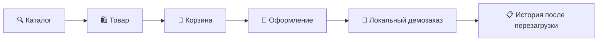

<a id="top"></a>

<div align="center">


# 🪐 ORVIX Marketplace

### От первого поиска до сохранённого заказа

**Каталог · Избранное · Корзина · Демозаказы**

Интерфейс маркетплейса с фиолетовыми градиентами, адаптивной навигацией<br />
и цельным покупательским сценарием на Next.js и TypeScript.

<p>
  
  
  
</p>
<p>
  
  
  
  
  
</p>

[🚀 Быстрый старт](#quick-start) · [✨ Возможности](#features) · [🧪 Проверки](#checks) · [🗺️ Развитие](#roadmap)

</div>

---

> **🧩 Статус проекта: функциональная фронтенд-демоверсия.**
> Товары поступают из DummyJSON, а корзина и демозаказы сохраняются в браузере.
> Собственный backend, PostgreSQL, настоящая авторизация, продавцы и платежи — следующие этапы.

<a id="about"></a>

## 💜 Знакомьтесь: ORVIX

ORVIX — проект маркетплейса, в котором можно пройти путь покупателя: найти товар, рассмотреть фотографии, сохранить в избранное, собрать корзину и оформить локальный демозаказ. После перезагрузки страницы покупка остаётся в истории этого браузера.

Визуальная основа проекта — **фиолетовая палитра, градиенты, скруглённые карточки и единая стилистика каталога, профиля и оформления**. Первый этап развития посвящён согласованной работе этих экранов и подготовке к серверной реализации.

| 🔎 Найти | 🛍️ Выбрать | 🛒 Собрать | 📦 Сохранить |
| :--- | :--- | :--- | :--- |
| Поиск, категории, сортировка | Галерея, описание, похожие товары | Количество, остатки, итоговая сумма | Демозаказ и локальная история |

<a id="navigation"></a>

## 🧭 Навигация

[✨ Возможности](#features) · [🛠️ Стек](#stack) · [🚀 Запуск](#quick-start) · [👤 Демо-вход](#demo-account) · [📦 Оформление](#checkout) · [🗂️ Маршруты](#routes) · [🏗️ Архитектура](#architecture) · [🧪 Проверки](#checks) · [🗺️ План развития](#roadmap) · [📌 Ограничения](#limitations)

<a id="features"></a>

## ✨ Что умеет приложение

### 🔍 Каталог и поиск

- Поиск по **названию, описанию, категории и бренду**.
- Фильтры по категории или наличию скидки; сортировка от дешёвых к дорогим и обратно.
- Пагинация по **12 товаров**: поиск и сортировка применяются ко всему набору до разбиения на страницы.
- Сброс на первую страницу при изменении поиска или фильтра.
- Скелетоны загрузки, сообщения об ошибках, повторный запрос и пустые результаты.

### 🛍️ Страница товара

- Галерея фотографий, описание, бренд, рейтинг и доступный остаток.
- Подборка похожих товаров и переход в категорию.
- Добавление в корзину и избранное прямо со страницы товара.
- Получение конкретного товара по ID и страница 404 для неизвестного товара или категории.

### 🛒 Корзина и избранное

- Повторное добавление увеличивает количество существующей позиции.
- Количество ограничено целыми положительными значениями и известным остатком; нулевой остаток запрещает добавление.
- Удаление позиции, очистка корзины и автоматический подсчёт суммы.
- Изображения и названия ведут на товар; кнопки количества работают отдельно от ссылок.
- Избранное обновляется сразу и сохраняется после перезагрузки.

### 📦 Демозаказы

- Четыре шага: **контакты и адрес → доставка → вариант оплаты → подтверждение**.
- Проверка обязательных данных; наличные доступны только для курьера.
- Постоянный ID, дата, снимок товаров и цен, сумма, контакты и демонстрационный статус.
- Корзина очищается только после успешной записи. При ошибке сохранения товары остаются на месте.
- История доступна гостю и демопользователю; повторное подтверждение с тем же ID не создаёт дубликат.

### 📱 Навигация и доступность

- Адаптивные сетки, мобильный каталог и доступ к основным разделам.
- Переключение Hero стрелками и точками; рабочие переходы к подборкам.
- Выбор города для гостя и демопользователя с сохранением в браузере.
- Управление меню и окном города через **Tab, Shift+Tab и Escape**, установка и возвращение фокуса.
- Недоступные разделы подвала обозначены текстом вместо фиктивных ссылок на `#`.

<a id="stack"></a>

## 🛠️ Технологии

| Технология | Роль в проекте |
| :--- | :--- |
| **Next.js 16.1.6** | App Router, серверные и клиентские компоненты |
| **React 19** | Компоненты и взаимодействия интерфейса |
| **TypeScript · strict** | Типизированные модели и границы модулей |
| **Zustand 5** | Корзина, избранное, город, демопрофиль и заказы |
| **TanStack Query 5** | Загрузка и кэширование данных на клиенте |
| **SCSS** | Палитра, компоненты, адаптивность и состояния |
| **DummyJSON** | Внешний тестовый источник товаров |
| **Vitest + Testing Library** | Проверка правил, состояния и компонентов |
| **Playwright** | Браузерные сценарии на десктопе и мобильном экране |

Ответы API и сохранённые данные проверяются во время выполнения. Дополнительная библиотека валидации на текущем этапе не используется.

<a id="quick-start"></a>

## 🚀 Быстрый старт

**Понадобятся:** Node.js **≥20.9.0**, npm и доступ к `dummyjson.com` / `cdn.dummyjson.com` для каталога и изображений. Требование Node.js взято из установленной версии Next.js.

```bash
# 1. Клонируйте проект
git clone https://github.com/bellatrisa1/ORVIX-MARKETPLACE-APP.git
cd ORVIX-MARKETPLACE-APP

# 2. Установите зависимости из lockfile
npm ci

# 3. Запустите приложение
npm run dev
```

**Откройте → [localhost:3000](http://localhost:3000)**

Для текущей демоверсии не нужны база данных, API-ключи или переменные окружения.

<details>
<summary><strong>📦 Production-сборка и альтернативный сборщик</strong></summary>

```bash
npm run build
npm start
```

Если ограниченная среда блокирует процесс обработки SCSS в Turbopack с ошибкой `binding to a port / Operation not permitted`, используйте альтернативную сборку:

```bash
npm run build:webpack
npm start
```

Сборка production-режима сама по себе не означает готовность демоверсии к реальным продажам.

</details>

<a id="demo-account"></a>

## 👤 Посмотрите демопрофиль

| Поле | Значение |
| :--- | :--- |
| 📧 Email | `demo@orvix.com` |
| 🔑 Пароль | `demo123` |
| 📍 Страница | `/profile` |

Это клиентская демонстрация входа. Пароль не входит в модель пользователя и не сохраняется в localStorage. История демозаказов относится **ко всему браузеру**, а не к защищённому аккаунту; для её просмотра вход не требуется.

<a id="checkout"></a>

## 📦 Покупательский путь



> **💡 Для оформления используйте вымышленные контакты.**
> Деньги не списываются, письмо не отправляется, доставка не выполняется. Данные банковской карты не запрашиваются. Пункт выдачи — демонстрационный вариант без выбора реального ПВЗ.

Все покупательские суммы отображаются в **USD**: так интерпретируются цены исходного интерфейса. Расчёт итогов выполняется в центах. Конвертации долларов в рубли нет.

<details>
<summary><strong>💾 Как устроено сохранение и восстановление</strong></summary>

- Ключ localStorage: `orvix-storage`; формат: `{ version: 1, state: ... }`.
- До восстановления сохранения изменения заблокированы, чтобы серверный HTML совпадал с первым клиентским отображением.
- Новый снимок записывается **до изменения состояния Zustand**. Заказ и очищенная корзина сохраняются одной операцией `setItem`.
- Старый формат версии 0 мигрируется с сохранением корзины, избранного и города: дубликаты объединяются, количество нормализуется, пароль удаляется.
- Прежние жёстко заданные `user.orders` не переносятся: это были демонстрационные фикстуры.
- Повреждённое или неизвестное сохранение не перезаписывается; интерфейс показывает ошибку и предлагает повторить загрузку.
- Удаление данных браузера удаляет и локальные заказы.

</details>

<a id="routes"></a>

## 🗂️ Карта приложения

| Маршрут | Раздел | Состояние |
| :--- | :--- | :--- |
| `/` | 🔍 Каталог, поиск и фильтры | ✅ Реализован |
| `/category/[slug]` | 🏷️ Категория, поиск и сортировка | ✅ Реализован |
| `/product/[id]` | 🛍️ Товар и похожие предложения | ✅ Реализован |
| `/cart` | 🛒 Корзина | ✅ Реализован |
| `/favorites` | 💜 Избранное | ✅ Реализован |
| `/checkout` | 📦 Оформление демозаказа | ✅ Локальное демо |
| `/checkout?order=demo-...` | 🧾 Сохранённый результат | ✅ Локальное демо |
| `/profile` | 👤 Демо-вход и история | ✅ Локальное демо |
| `/ideas` · `/sales` · `/services` | 💡 Идеи, акции и услуги | 🧩 Заготовки разделов |
| `/support` · `/gift-cards` · `/business` · `/mobile` | 📄 Информационные страницы | 🧩 Демо-контент |

**14 пользовательских шаблонов маршрутов.** Параметр `?order=...` показывает результат на существующем маршруте `/checkout`.

<a id="architecture"></a>

## 🏗️ Как устроен проект

```text
ORVIX-MARKETPLACE-APP/
├── public/
│   └── ORVIX-LOGO.png          # Логотип проекта
├── src/
│   ├── app/                   # Страницы App Router
│   │   └── styles/            # Базовые стили, оформление, локальные исправления
│   ├── components/            # Карточки, меню, пагинация, история
│   ├── hooks/                 # Управление фокусом
│   ├── lib/                   # API, правила покупки и локальное сохранение
│   ├── test/                  # Unit- и компонентные тесты
│   ├── types/                 # Модели API, пользователя и демозаказа
│   └── store.ts               # Zustand и команды интерфейса
├── e2e/                       # Браузерные сценарии Playwright
└── docs/                      # Проверки и план серверного развития
```

| Модуль | Ответственность |
| :--- | :--- |
| `products.ts` | HTTP-граница DummyJSON, валидация, получение конкретного товара и похожих товаров |
| `catalog.ts` | Поиск, фильтры, сортировка и пагинация полного набора |
| `cart.ts` · `checkout.ts` · `money.ts` | Количество, оформление, снимки покупки и расчёты |
| `demo-storage.ts` | Версия сохранения, миграция, проверка данных и запись |
| `store.ts` | Команды UI и обновление состояния после успешного сохранения |

Базовые стили и стили оформления выделены постепенно, с сохранением прежнего каскада. Серверный план развивает эти границы модулей; PostgreSQL пока не подключён.

<a id="checks"></a>

## 🧪 Проверки качества

```bash
npm run lint                         # ESLint
npm run typecheck                    # TypeScript
npm run test -- --run                # Unit- и компонентные тесты
npm run build                        # Production-сборка
npx playwright install chromium      # Браузер для E2E
npm run test:e2e                      # Покупательские сценарии
```

### 📋 Зафиксированные результаты этапа 1

| Проверка | Результат от 9 октября 2026 года |
| :--- | :--- |
| ESLint | ✅ Без предупреждений |
| TypeScript | ✅ Без ошибок |
| Vitest | ✅ **43 теста** в 2 файлах |
| Production build | ✅ Turbopack |
| Playwright | ✅ **6 сценариев** на desktop и mobile |
| Проверка diff | ✅ Без ошибок пробелов |

Это **исторические результаты конкретного прогона**, а не автоматически обновляемый статус текущего checkout. Команды, границы проверки и риски зависимостей описаны в [отчёте проверки →](docs/verification.md).

<details>
<summary><strong>🌐 Что проверяют браузерные сценарии</strong></summary>

Playwright запускает production-сервер на `127.0.0.1:3109`, поэтому перед E2E нужна сборка. Размеры Chromium: **1440×1000** и **390×844**.

- Каталог → товар → корзина → демозаказ → история → перезагрузка.
- Реальное сохранение через localStorage браузера и загрузка товаров из DummyJSON.
- Двойное подтверждение, постоянный ID и отсутствие дублирующего заказа.
- Избранное, город гостя, мобильное меню и управление фокусом.
- Неизвестные товары и категории, Hero и рабочая ссылка предложений.
- Сохранность корзины при искусственном отказе `setItem`. Подмена используется только для воспроизведения ошибки записи.

Тесты зависят от доступности внешнего демоисточника. Скриншоты и трассы записываются в игнорируемый `test-results/`, HTML-отчёт — в `playwright-report/`.

</details>

<a id="roadmap"></a>

## 🗺️ Куда движется ORVIX

| Этап | Направление | Статус |
| :--- | :--- | :--- |
| **01** | Цельный демосценарий, исправления и локальные заказы | ✅ Реализован |
| **02** | Адресное обновление зависимостей и CI | 🔜 Следующий шаг |
| **03** | PostgreSQL, миграции и серверные модули | 📋 Запланирован |
| **04** | Настоящие пользователи и серверные сессии | 📋 Запланирован |
| **05** | Собственный каталог, продавцы и управление площадкой | 📋 Запланирован |
| **06** | Заказы, разделение по продавцам и транзакционные резервы | 📋 Запланирован |
| **07** | Тестовая оплата, повторные уведомления и отмена | 📋 Запланирован |
| **08** | Доставка, уведомления и эксплуатационные проверки | 📋 Запланирован |

Архитектура, правила доступа, идемпотентность и интеграционные проверки разобраны в [плане full-stack реализации →](docs/fullstack-roadmap.md).

<a id="limitations"></a>

## 📌 Что важно знать о демоверсии

| Сейчас | Граница реализации |
| :--- | :--- |
| 💾 Данные браузера | localStorage можно изменить вручную; очистка браузера удаляет заказы |
| 👤 Демо-вход | Нет защищённых аккаунтов, серверных сессий и приватной истории |
| 📦 Остатки | Клиентская проверка может устареть и не защищает от одновременных покупок |
| 🔄 Несколько вкладок | Нет транзакционного согласования; последний записанный снимок побеждает |
| 🔍 Каталог | Небольшой демонабор загружается целиком; серверная пагинация впереди |
| 💳 Покупка | Нет списания денег, отправки писем, реальной доставки и кабинетов продавцов |
| 📄 Дополнительные разделы | Поддержка, подарочные карты, приложение и юридические документы ещё не работают как сервисы |
| 🌐 Совместимость | Chromium-проверки не заменяют Safari, Firefox и реальные устройства |

Реальные продажи потребуют серверной реализации и отдельной проверки готовности к эксплуатации. План обновления зависимостей и результаты npm audit зафиксированы в [документации проверки](docs/verification.md#ограничения-среды-и-оставшиеся-риски).

---

<div align="center">

### 🪐 ORVIX — проект, который растёт вместе с идеей

**Интерфейс уже можно исследовать. Серверная часть — следующий большой шаг.**

[💻 Репозиторий](https://github.com/bellatrisa1/ORVIX-MARKETPLACE-APP) · [📋 Проверки](docs/verification.md) · [🗺️ План развития](docs/fullstack-roadmap.md)

[↑ К началу](#top)

</div>
